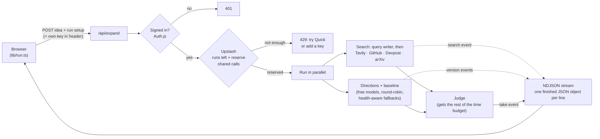

# Brainy

**Turn a half-baked idea into genuinely different finished versions, check them against what already exists, and get a straight verdict on which one to chase.**

**Live:** [brainy-io.vercel.app](https://brainy-io.vercel.app)

<!-- Demo GIF: record a run and save it as docs/demo.gif -->


---

## What it does

- **Divergent directions.** Your idea is pushed 3, 6 or 9 deliberately different ways (a different customer, the opposite market, a hardware hack, a benchmark…), spread across several free models, next to an optional plain baseline for comparison.
- **Live search.** While the models write, Brainy searches the web, GitHub, Devpost and arXiv for things that already do this.
- **A judge's verdict.** A judge model reads every version and every search result, rates how crowded the space is (Fresh / Crowded / Very saturated), and picks the most unique direction that could still work. Every "similar thing" it cites is a real search result.
- **Idea breeding and a lineage tree.** Pick any two ideas and cross them into three offspring that each inherit a trait from both parents. Keep breeding across generations, ask the judge to rank a generation, and explore the family tree (pan, zoom, ancestor highlighting).
- **Hackathon: "Built before".** Similar past Devpost projects, each rated for how close it is, plus "the twist none of them tried".
- **Research: "Papers that almost did this".** The closest arXiv papers, what each did and didn't do, and the gap your idea fills. The judge flags it when it isn't sure.

The site stays black and white until a real result is cooked, then blooms into colour.

---

## Architecture

### One run



The stream sends `start → search / baseline / version (in any order) → take → done`, each event the moment its piece is finished. When the run ends, unused reserved calls go back to the shared pool.

### Where data lives

| Data | Where | Notes |
| --- | --- | --- |
| History, saved results, family trees, settings | **Browser `localStorage`** (default) | Works without any server-side storage |
| The same, when the user opts in | **Neon Postgres** via Drizzle ORM | `users`, `results`, `user_settings`, all scoped to the session's user |
| Bring-your-own API keys | **Browser only** | Sent per request in a header, never stored or logged |
| Runs-left counters, shared call pool, model health, model list cache, arXiv cache | **Upstash Redis** | Counts, flags and cached public search results; nothing tied to an account except daily counts |

---

## Engineering decisions

**Streaming finished JSON events, not partial JSON.** Each model call is validated against its schema on the server and only then sent as one complete NDJSON line. The browser never parses half a JSON object, a failed direction is simply missing, and results fill in as they finish (the search, each direction, then the verdict).

**Free-model health tracking and fallback chains.** The model list comes live from OpenRouter, cached for an hour, filtered to free text models with at least 32k context and no tiny or special-purpose models. A 429, 5xx or timeout marks a model *busy* for 10 minutes, and a 404 marks it *unavailable* for an hour, in one shared Upstash hash. Auto picks and every fallback chain skip flagged models. Key-wide limits (like OpenRouter's daily free cap) never get blamed on a model. Directions spread round-robin across 1–4 models, and each call tries at most 3 models, so one bad model can't drain the quota.

**A shared quota counted in model calls, with atomic reservation.** The server key's daily allowance counts *calls*, not runs, because fallbacks and retries cost real requests. A run reserves its estimated calls up front in a single Lua script, so two concurrent runs can't both take the last few. Extra calls draw from whatever is left, and unused calls go back at the end. When OpenRouter reports its daily free cap, the pool is marked out until midnight UTC. Run sizes (Quick ~5, Standard ~8, Full ~12 calls) and an inline warning let users trade depth for quota.

**Bring-your-own keys that never leave the browser.** Keys sit in `localStorage` and travel per request in a header. The server format-checks them, uses them for that one request, and never stores, logs or echoes them. If a key is rejected, the user is told so; Brainy never quietly falls back to its own key.

**Privacy-first, opt-in sync.** Everything is local by default. Turning on sync uploads existing results. After that, each change is queued in `localStorage` (so closing the tab loses nothing) and sent shortly after. Other devices pull only what changed since their last pull: the newer copy of a result wins, and deletions made elsewhere are applied. Turning sync off asks whether to keep or delete the cloud copy, and "Delete my data" wipes the cloud copy and the local one.

**Account linking on verified email only.** One person signing in with Google on their phone and GitHub on their laptop should be one account, with one runs-left counter and one synced history. Accounts are merged on email only when the provider vouches for it: Google's `email_verified`, or GitHub's primary address marked verified in its emails API. Otherwise the id falls back to the provider id, so nobody can add someone else's address to an account and inherit their data.

**Public share links with sanitised content.** A synced result can be made public at `/r/[slug]`: read-only, no sign-in needed, its own social preview image, `noindex`. Slugs are 72 random bits. Uploads are size-capped and every `url` field is reduced to plain `http(s)` before storing, so a crafted result can't put a `javascript:` link on a public page. Sharing state is decided by the server, never taken from the client.

**Grounded citations.** The judge refers to search results by id, and the server looks up every title, link, author and year itself, so it can't invent a paper, project or URL.

---

## Tech stack

- **App:** Next.js 15 (App Router), React 19, TypeScript, Tailwind CSS v4
- **Auth:** Auth.js v5 (Google, GitHub), JWT sessions
- **AI:** OpenRouter (free models on the server key; any model on a user's own key)
- **Search:** Tavily (web, and Devpost via domain filter), GitHub search API, arXiv API
- **Data:** Neon Postgres + Drizzle ORM (opt-in sync), Upstash Redis + `@upstash/ratelimit`
- **Hosting:** Vercel

---

## Running locally

```bash
cp .env.example .env.local   # fill in the values (see comments in the file)
npm install
npm run dev                  # http://localhost:3000
```

- **Required:** `OPENROUTER_API_KEY`, `AUTH_SECRET` (`npx auth secret`), and a Google and/or GitHub OAuth app (`AUTH_GOOGLE_*`, `AUTH_GITHUB_*`) with callback `http://localhost:3000/api/auth/callback/<provider>`.
- **Optional:** `TAVILY_API_KEY` (web search), `GITHUB_TOKEN` (higher GitHub search limits), `GLOBAL_DAILY_CALLS` (shared pool size, default 45).
- **Limits:** leave the Upstash vars blank to turn limits off locally. Always set them for a public deploy.
- **Sync:** point `DATABASE_URL` / `DATABASE_URL_UNPOOLED` at a **Neon dev branch** so local testing never touches production data, then apply migrations:

  ```bash
  npm run db:migrate        # uses DATABASE_URL_UNPOOLED
  npm run db:generate       # after changing lib/server/db/schema.ts
  ```

  Leave both blank to run without sync.

Scripts: `npm run dev` · `npm run build` · `npm run lint`

---

## How it was built

Brainy was built with [Claude Code](https://claude.com/claude-code), Anthropic's agentic coding tool, as the implementation agent, with me as the lead. I defined the product, set the requirements for each stage, reviewed every plan before approving it, made the architecture and security calls, and tested each release on the live site.

Decisions I made along the way:

- **Privacy-first storage:** local by default, with cloud sync strictly opt-in.
- **Bring-your-own key**, added after user feedback, so heavy users aren't limited by the shared pool.
- **Free-only mode** on the server key, with user-chosen run sizes and a calls-based shared quota instead of a run count.
- **Verified-email-only account linking**, so accounts are never merged on an unverified address.
- **The colour reveal reserved for real cooked results**; the home-page sample stays monochrome.
- **A separate Neon dev branch** for local work, so testing never touches production data.

Process: staged builds, each following plan → review → build → regression checklist → deploy.

---

## Credits

Built by Rohith · [github.com/rohithkarning-debug](https://github.com/rohithkarning-debug)
