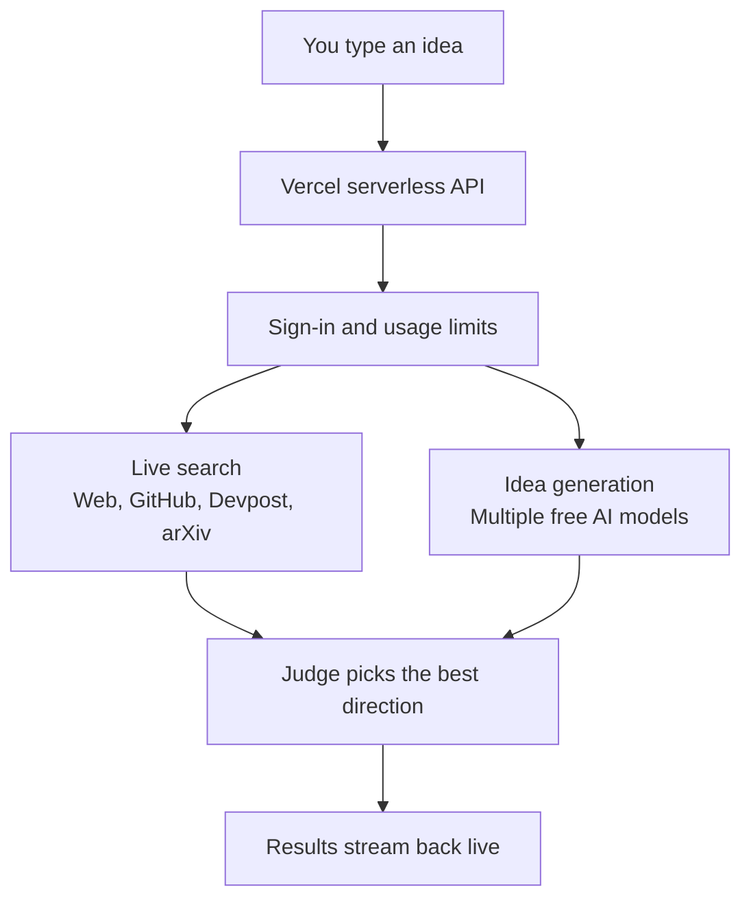

# Brainy

**Turn a half-baked idea into genuinely different finished versions, check them against what already exists, and get a straight verdict on which one to chase.**

**Live:** [brainy-io.vercel.app](https://brainy-io.vercel.app)

<!-- Demo GIF: record a run and save it as docs/demo.gif -->


---

## Why I built this

**What problem does it solve?**
Every hackathon, research paper or startup idea starts the same way: you have a rough idea, and you need to find the version of it that's actually worth building. I struggled with this myself, and I kept seeing friends and classmates stuck at the same point. The first version you think of, or the one an AI hands you, is usually the obvious one, and it often already exists. Brainy takes your idea, pushes it in several deliberately different directions, checks each one against what's already out there, and tells you honestly which one is worth chasing.

**Who uses it?**
I built it for myself first, then asked friends to try it and tell me what worked and what didn't. Their feedback shaped a lot of what Brainy is today. It's now live for anyone to use, especially students trying to find the strongest version of their idea.

**What happened when something went wrong?**
- **History didn't follow you between devices.** A friend signed in with the same Google account on his phone and laptop, and his history only showed up on one of them, because it was saved in the browser. I added optional cloud sync, so you can choose to keep your history with your account across every device, while it stays private and local by default.
- **Big runs burned through the shared AI quota.** Every direction is a separate AI call, so larger runs used up the free limit fast. I added run sizes so you can choose how big a run should be, and a bring-your-own-key option: you can plug in your own free API key, which stays in your browser and is never stored on our servers.

---

## Features

### 1. Divergent directions
Type a rough idea and choose what it's for: **Startup**, **Hackathon** or **Research**. The purpose changes what a "finished" version looks like. Brainy then pushes the idea in several deliberately different directions, such as a different customer, the opposite market, an inverted assumption, or a hardware or technical twist, so you see possibilities you wouldn't have thought of.

- **Run sizes:** Quick (3 directions), Standard (6) or Full (9). Even Quick is curated to cover a wide spread instead of just the first few angles.
- **Multiple models:** directions are spread across different AI models, because different models think differently. You can let Brainy choose (Auto) or pick 1–4 models yourself.
- **The baseline:** an optional "obvious answer", what a typical AI would say, shown next to the directions so you can see how far each one moves away from it. It's on by default for Full runs.

### 2. Checked against reality
While the directions are being generated, Brainy searches for what already exists so you aren't reinventing something. It writes focused search queries, then looks across the web, GitHub, Devpost and arXiv depending on the purpose. Every link and title it shows comes from real search results. If the search can't run, the verdict says so and only names things the model already knows, with no links.

### 3. An honest verdict
A judge model reads every direction alongside the search results and tells you how crowded the space is, which direction is the most original idea that could still work, and what to explore next, with follow-up ideas that open the Ask page pre-filled. If the judge fails, you can pick a different judge model and re-run only the verdict, without using up a run (up to 10 times a day).

### 4. Idea breeding 🧬
The most experimental feature: treat ideas like a genetic algorithm.
- **Cross two ideas:** select any two directions and press **Cross**. Brainy creates three "offspring" that genuinely combine both parents instead of just stapling them together. Each one says what it inherits, for example *"inherits the B2B model from A and the offline-first approach from B."*
- **Keep evolving:** cross offspring with each other, or with the original directions, to build generation 2, generation 3 and beyond. You choose which ideas are worth breeding further.
- **Lineage tree:** the **Lineage** tab draws the whole family tree, from your original idea through each direction to every generation of offspring. Pan, pinch or Ctrl/⌘ + scroll to zoom, and hover over (or focus) any idea to highlight its whole line of ancestors. On phones it switches to a vertical layout.
- **Judge a generation:** send a generation of offspring (all of it, or up to 9 you pick) to the judge for a fresh verdict, and save the ones you like. The whole tree is saved with the result, so it's still there when you come back.

### 5. "Built before" (Hackathon mode)
Hackathon ideas get repeated a lot. Brainy finds similar past hackathon projects, shows how close each one is, and points out **the twist none of them tried**. If nothing similar turns up, it says so, which is a good sign.

### 6. "Papers that almost did this" (Research mode)
For research ideas, Brainy finds the closest papers on arXiv, shows what each one did and didn't do, and names **the gap** your direction could fill. It only cites papers it actually found, and says so when it isn't sure.

### 7. Live, streaming results
Results don't arrive all at once at the end. While Brainy works, rotating "Cooking…" messages show progress, and each card appears the moment it's ready. You can stop a run at any time, which also cancels the AI calls still running so nothing is wasted. You can also regenerate, or retry if something fails.

### 8. Monochrome until it's cooked
The whole site is black and white, and stays that way until your idea is ready. When the run finishes, the page blooms into colour: a slowly flowing gradient, coloured cards, and the winning direction highlighted. Example content stays monochrome, so colour always means *your* result. It respects reduced-motion settings.

### 9. Your history, your control
- **History and Saved:** search, filter, save and delete past results.
- **Private by default:** results stay in your browser. Turn on **cloud sync** if you want your history on every device you sign in on, and turn it off anytime, choosing whether to keep or delete the cloud copy.
- **Public links:** make any synced result public to share a read-only page anyone can open, and make it private again with one click.
- **Delete my data:** wipes your cloud copy and this browser's history, settings and keys in one step.

### 10. Free to use, or bring your own key
Every account gets 5 free runs a day, drawn from a shared daily pool of free AI requests. Brainy shows how many requests a run will use and warns you before big runs. Add your own OpenRouter key in Settings (a free account works) to get your own quota and any model on OpenRouter, including paid ones billed to your key. Your key stays in your browser and is never stored on our servers.

### 11. Make it yours
Light or dark theme, answer length, tone, font size, and an animations toggle. Keyboard shortcuts: **Ctrl/⌘ + K** jumps to the idea box from anywhere, **Enter** cooks (**Shift + Enter** for a new line), and the **← →** arrow keys move between result tabs once the tab bar is focused.

---

## Architecture



**One run, in detail.** The browser posts the idea and run setup to `/api/expand`. A signed-out request gets a 401. Next, Upstash checks the user's runs left and atomically reserves the run's estimated model calls from the shared pool, or refuses with a 429. Search (a query-writing call, then Tavily, GitHub, Devpost and arXiv) and generation (directions spread round-robin across free models, with health-aware fallbacks) run in parallel. The judge gets whatever is left of the time budget. The response is an NDJSON stream: `start → search / baseline / version (in any order) → take → done`, each event sent the moment its piece is finished. When the run ends, unused reserved calls go back to the pool.

### Where data lives

| Data | Where | Notes |
| --- | --- | --- |
| History, saved results, family trees, settings | **Browser `localStorage`** (default) | Works without any server-side storage |
| The same, when the user opts in | **Neon Postgres** via Drizzle ORM | `users`, `results`, `user_settings`, all scoped to the session's user |
| Bring-your-own API keys | **Browser only** | Sent per request in a header, never stored or logged |
| Runs-left counters, shared call pool, model health, model list cache, arXiv cache | **Upstash Redis** | Counts, flags and cached public search results; nothing tied to an account except daily counts |

---

## Engineering decisions

**Streaming finished JSON events, not partial JSON.** Each model call is validated against its schema on the server and only then sent as one complete NDJSON line. The browser never parses half a JSON object, a failed direction is simply missing, and results fill in as they finish (the search, each direction, then the verdict).

**Free-model health tracking and fallback chains.** The model list comes live from OpenRouter, cached for an hour, filtered to free text models with at least 32k context and no tiny or special-purpose models. A 429, 5xx or timeout marks a model *busy* for 10 minutes, and a 404 marks it *unavailable* for an hour, in one shared Upstash hash. Auto picks and every fallback chain skip flagged models. Key-wide limits (like OpenRouter's daily free cap) never get blamed on a model. Directions spread round-robin across 1–4 models, and each call tries at most 3 models, so one bad model can't drain the quota.

**A shared quota counted in model calls, with atomic reservation.** The server key's daily allowance counts *calls*, not runs, because fallbacks and retries cost real requests. A run reserves its estimated calls up front in a single Lua script, so two concurrent runs can't both take the last few. Extra calls draw from whatever is left, and unused calls go back at the end. When OpenRouter reports its daily free cap, the pool is marked out until midnight UTC. Run sizes (Quick ~5, Standard ~8, Full ~12 calls) and an inline warning let users trade depth for quota.

**Bring-your-own keys that never leave the browser.** Keys sit in `localStorage` and travel per request in a header. The server format-checks them, uses them for that one request, and never stores, logs or echoes them. If a key is rejected, the user is told so; Brainy never quietly falls back to its own key.

**Privacy-first, opt-in sync.** Everything is local by default. Turning on sync uploads existing results. After that, each change is queued in `localStorage` (so closing the tab loses nothing) and sent shortly after. Other devices pull only what changed since their last pull: the newer copy of a result wins, and deletions made elsewhere are applied. Turning sync off asks whether to keep or delete the cloud copy, and "Delete my data" wipes the cloud copy and the local one.

**Account linking on verified email only.** One person signing in with Google on their phone and GitHub on their laptop should be one account, with one runs-left counter and one synced history. Accounts are merged on email only when the provider vouches for it: Google's `email_verified`, or GitHub's primary address marked verified in its emails API. Otherwise the id falls back to the provider id, so nobody can add someone else's address to an account and inherit their data.

**Public share links with sanitised content.** A synced result can be made public at `/r/[slug]`: read-only, no sign-in needed, its own social preview image, `noindex`. Slugs are 72 random bits. Uploads are size-capped and every `url` field is reduced to plain `http(s)` before storing, so a crafted result can't put a `javascript:` link on a public page. Sharing state is decided by the server, never taken from the client.

**Grounded citations.** The judge refers to search results by id, and the server looks up every title, link, author and year itself, so it can't invent a paper, project or URL.

---

## Tech stack

- **App:** Next.js 15 (App Router), React 19, TypeScript, Tailwind CSS v4
- **Auth:** Auth.js v5 (Google, GitHub), JWT sessions
- **AI:** OpenRouter (free models on the server key; any model on a user's own key)
- **Search:** Tavily (web, and Devpost via domain filter), GitHub search API, arXiv API
- **Data:** Neon Postgres + Drizzle ORM (opt-in sync), Upstash Redis + `@upstash/ratelimit`
- **Hosting:** Vercel

---

## Running locally

```bash
cp .env.example .env.local   # fill in the values (see comments in the file)
npm install
npm run dev                  # http://localhost:3000
```

- **Required:** `OPENROUTER_API_KEY`, `AUTH_SECRET` (`npx auth secret`), and a Google and/or GitHub OAuth app (`AUTH_GOOGLE_*`, `AUTH_GITHUB_*`) with callback `http://localhost:3000/api/auth/callback/<provider>`.
- **Optional:** `TAVILY_API_KEY` (web search), `GITHUB_TOKEN` (higher GitHub search limits), `GLOBAL_DAILY_CALLS` (shared pool size, default 45).
- **Limits:** leave the Upstash vars blank to turn limits off locally. Always set them for a public deploy.
- **Sync:** point `DATABASE_URL` / `DATABASE_URL_UNPOOLED` at a **Neon dev branch** so local testing never touches production data, then apply migrations:

  ```bash
  npm run db:migrate        # uses DATABASE_URL_UNPOOLED
  npm run db:generate       # after changing lib/server/db/schema.ts
  ```

  Leave both blank to run without sync.

Scripts: `npm run dev` · `npm run build` · `npm run lint`

---

## How it was built

Brainy was built with [Claude Code](https://claude.com/claude-code), Anthropic's agentic coding tool, as the implementation agent, with me as the lead. I defined the product, set the requirements for each stage, reviewed every plan before approving it, made the architecture and security calls, and tested each release on the live site.

Decisions I made along the way:

- **Privacy-first storage:** local by default, with cloud sync strictly opt-in.
- **Bring-your-own key**, added after user feedback, so heavy users aren't limited by the shared pool.
- **Free-only mode** on the server key, with user-chosen run sizes and a calls-based shared quota instead of a run count.
- **Verified-email-only account linking**, so accounts are never merged on an unverified address.
- **The colour reveal reserved for real cooked results**; the home-page sample stays monochrome.
- **A separate Neon dev branch** for local work, so testing never touches production data.

Process: staged builds, each following plan → review → build → regression checklist → deploy.

---

## Credits

Built by Rohith · [github.com/rohithkarning-debug](https://github.com/rohithkarning-debug)
